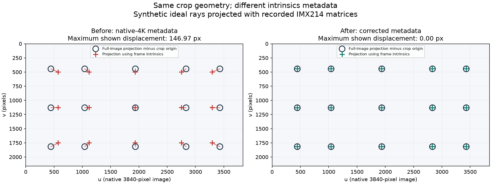

# Camera calibration compatibility

This fix requires no new public API or changes to existing calibration files.
Existing `setCameraIntrinsics` and `getCameraIntrinsics` retain their behavior.
The latter remains a generic image resize/crop helper and does not select a
physical sensor readout.

RVC2 retains its existing normalization of calibration records. For example,
both a full 4208×3120 IMX214 calibration and an existing native 3840×2160
calibration are mapped through the historical normalization into physical sensor
coordinates. The corrected output mapping then applies the selected readout's
crop and bin/scale once. For that native unbinned crop, focal lengths remain
unchanged and the principal point is shifted by its physical crop origin.
No recalibration, new call or EEPROM rewrite is needed for these cases.

RVC4 retains its historical interpretation of reduced-resolution calibration
using the existing full-sensor resize/crop rules. The selected sensor crop is
applied consistently at startup and on runtime calibration updates. Calibration
image dimensions are not reinterpreted as proof of a native capture mode.

A calibration's width and height alone cannot distinguish a native sensor crop
from a processed image of the same size. The fix preserves existing interpretation;
it does not automatically repair arbitrary files with unknown capture provenance.

Camera frame metadata follows the actual output crop and scale. Code consuming
processed frames can use the existing per-frame transformation API:

```python
K = frame.getTransformation().getIntrinsicMatrix()
```

```cpp
auto K = frame->getTransformation().getIntrinsicMatrix();
```

The firmware change corrects metadata for affected readouts without changing
image pixels or the generic CalibrationHandler API contract.

## Before/after projection example

An IMX214 hardware capture with released DepthAI 3.12.0 selected the native
3840×2160 readout at (184, 480) within the 4208×3120 sensor. That unscaled crop
must retain focal length and subtract its origin from the principal point.
The recorded native-readout metadata instead contained the intrinsics for a
resized image. An explicit crop of the full readout already returned the
expected intrinsics on the same released version.

| Parameter | Before: native readout | After: corrected build | Expected from full readout |
| --- | ---: | ---: | ---: |
| fx | 2724.1130 | 2985.1738 | 2985.1738 |
| fy | 2723.8677 | 2984.9050 | 2984.9050 |
| cx | 1936.2173 | 1937.7715 | 1937.7715 |
| cy | 1125.9661 | 1130.3711 | 1130.3711 |

The focal error is -8.745% relative to the expected focal length, not a
percentage of incorrectly calibrated devices or a calibration-target residual.
The matrices come from saved before/after hardware captures during development;
the final published replacement separately passed full/native-reference tests.



The landmarks in this figure are synthetic ideal rays. Their reference pixels
are computed by projection into the full image followed by subtraction of the
physical crop origin. No lens distortion is simulated. For a ray (X/Z, Y/Z) =
(0.3, 0), the expected pixel is (2833.324, 1130.371); old metadata projects it
to (2753.451, 1125.966), a 79.994-pixel displacement. Corrected metadata matches
the crop expectation to the shown precision. This is a coordinate-mapping
demonstration, not an independent measurement of physical target accuracy.

Reproduce the figure and numeric table without a camera:

```sh
python -m pip install numpy matplotlib
python docs/calibration-native-crop-example.py
```

The recorded inputs are in [calibration-native-crop-example.json](calibration-native-crop-example.json).
The script also demonstrates why a projection/unprojection round trip using
the same incorrect K can pass: K and its inverse cancel. A visually normal
image, resize-only pixel mapping, or such a round trip does not establish
correct camera rays. Projections between independently calibrated cameras,
undistortion, alignment and metric 3D can expose a mismatch when the affected
metadata is used. A focal-length percentage does not directly describe the
resulting pixel, depth or extrinsics error.

Existing production calibration records are not rewritten by this fix. A
calibration fit can have a low residual in its own capture coordinates while
its later conversion to another sensor readout is wrong. The tested full/native
RVC2 references require no recalibration for this mapping fix. This does not
certify every historical production record: capture FOV, stored dimensions and
the consuming firmware path still need to agree. In particular, dimensions
alone cannot resolve unknown capture provenance on RVC4. Earlier synthetic
RVC4 results that assumed native-crop semantics for reduced calibration records
are not evidence that all such production records were incorrectly calibrated;
the final implementation preserves their historical interpretation.

## Extended hardware coverage

`camera_sensor_geometry_extended_test` runs in the nightly HIL selection. It
exercises every distinct advertised resolution, sensor type, HDR and HFR variant
using the existing Camera API, including sensor readouts above 16 MP. Large
readouts use smaller output streams to bound host bandwidth. Half-size YUV output
is tested only when its dimensions are even. Each failure is retained while the
extended run continues to assess the remaining modes.

For an explicit device/firmware selection, the same coverage can be run with
`DEPTHAI_GEOMETRY_EXTENDED=1` and the `camera_sensor_geometry_test` executable.
These tests cover geometry at supported selected frame rates, not every FPS,
exposure setting or possible combination of application nodes.
