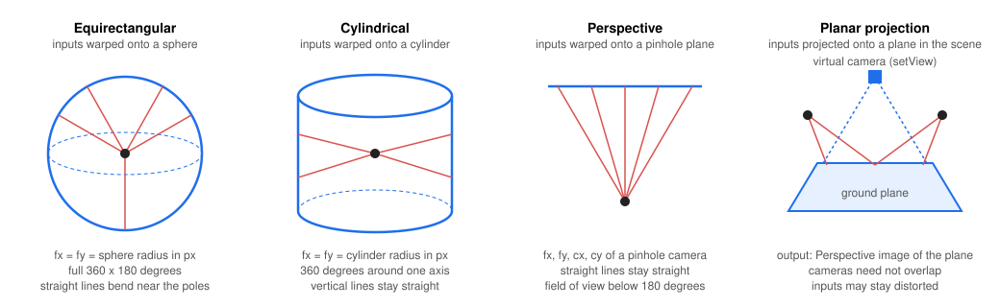
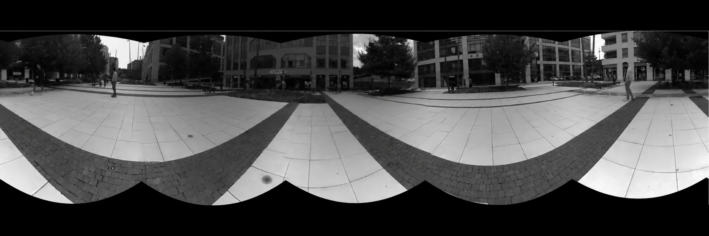
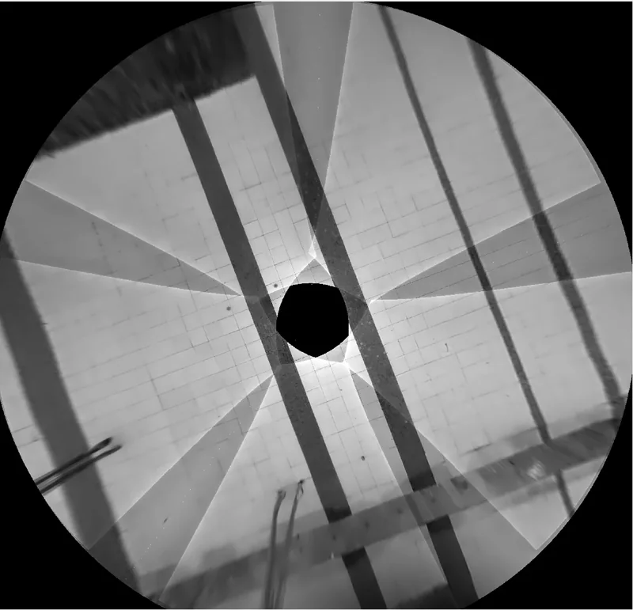

# Multi-device stitching examples (Python)

These examples combine one camera from each of two or more devices in one host pipeline:

| Example | Output |
|---------|--------|
| `multi_device_stitching_panorama.py` | Calibrated panorama, cylindrical by default for a camera ring. |
| `multi_device_stitching_planar_projection.py` | Calibrated planar projection, such as a bird's-eye view of the ground. |

For the simpler factory-calibrated `CAM_B` + `CAM_C` pair on **one device**, use the
[HostNodes stitching examples](../HostNodes/README.md#stitching).

## Calibration and setup

Build DepthAI with OpenCV support and `DEPTHAI_BUILD_BETA=ON`. The stitching node itself is stable;
loading a cross-device calibration JSON uses the beta `MultiDeviceCalibrationHandler` API.

`--devices` takes at least two device IDs or IP addresses. `--socket` selects the camera on every device
(default: `CAM_A`). `--calibration` is required: supply a graph saved by `MultiDeviceCalibrationHandler`,
for example the JSON output of the [MultiDeviceCalibration example](../MultiDeviceCalibration/).

Calibrate the actual devices in their fixed mounting positions first. The graph must connect all selected devices
into one common origin, using their device IDs. Its edges join the devices' local calibration-origin sockets;
factory calibration relates the selected camera to that local origin. IP addresses select connections, while
calibration identifies devices by device ID. Camera poses are never inferred from command-line order.
The examples load the graph with `setMultiDeviceCalibration()` before pipeline start, so input frames carry
intrinsics and extrinsics in a shared coordinate system. Keep the cameras fixed after calibration.

## Panorama

```bash
python3 multi_device_stitching_panorama.py \
  --devices 192.168.1.10 192.168.1.11 192.168.1.12 192.168.1.13 192.168.1.14 \
  --calibration rig.json --socket CAM_A --projection Cylindrical
```

`--projection` accepts `Cylindrical` (default, suitable for a ring), `Equirectangular` (sphere), or
`Perspective` (pinhole plane, for a narrow combined field of view below 180 degrees).
Inputs are requested undistorted, and composition uses their calibrated intrinsics and rotations;
camera translations are ignored. See the [projection descriptions](../HostNodes/README.md#panorama-stitching_panoramapy)
for more details.



Five OAK4 devices in a ring on a city square, composed from their calibration:



## Planar projection

```bash
python3 multi_device_stitching_planar_projection.py \
  --devices 192.168.1.10 192.168.1.11 192.168.1.12 192.168.1.13 192.168.1.14 \
  --calibration rig.json --socket CAM_A --plane-point 0 150 0 --plane-normal 0 1 0
```

Set `--plane-point X Y Z` in centimetres and `--plane-normal X Y Z` in the **common calibration origin's**
coordinate system (X right, Y down, Z forward). This command assumes a level origin with the ground 150 cm below it;
measure and adjust these values for your rig. The defaults (`0 0 130` and `0 1 1`) describe a tilted demonstration
plane. Planar projection uses both rotations and translations, as well as the inputs' lens distortion model.
The virtual view fits all camera footprints, bounded by `setMaxViewSize()` and `setMaxRange()`.

The same five cameras projected onto the pavement; no camera sees the ground directly under the rig:



The host Sync node matches host-clock timestamps within two frame periods. This is software synchronization;
use hardware synchronization if scene motion requires simultaneous exposures. Both examples stop if a device
is permanently lost. Press `q` in the preview window to exit.
